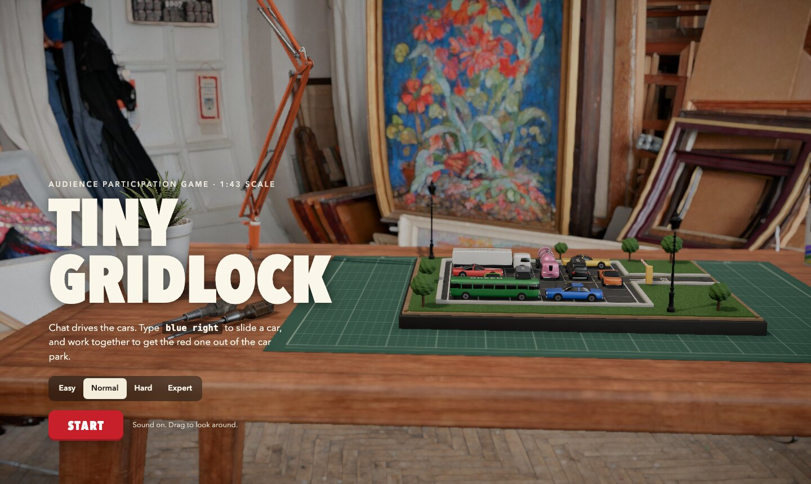
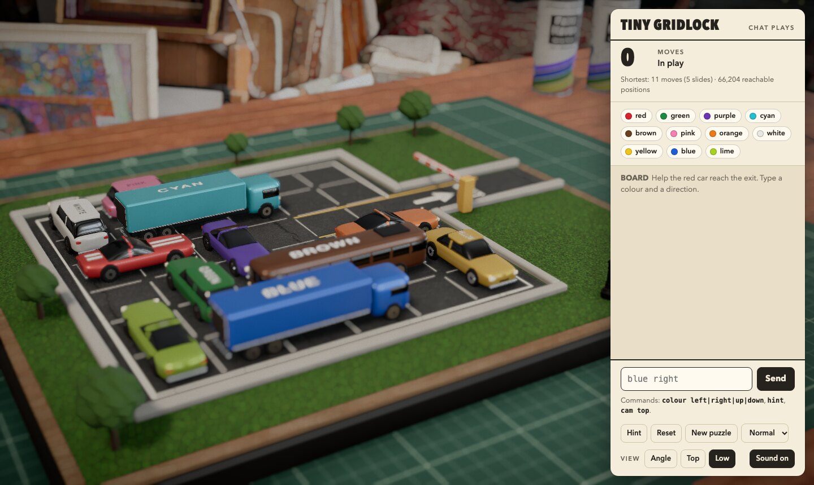

# Tiny Gridlock — diorama build

A photoreal presentation of the Rush Hour APG puzzle. The car park is a 1:43 scale model on a
hobby workbench. Chat commands slide die-cast cars until the red car reaches the exit.




## Run

The page loads ES modules, an HDR image and glTF models, so it needs an HTTP server.
Opening `index.html` from the file system does not work.

```sh
cd diorama
bunx serve .        # or: python3 -m http.server 8000
```

Open the printed address in a desktop browser. No build step and no network access are needed:
three.js 0.187.0, postprocessing 6.39.6 and n8ao 2.0.2 are in `vendor/`.

## Play

- `blue right`, `red left`, `green up`, `yellow down`: slide a vehicle one cell.
- `hint`: the next move of a shortest solution. The vehicle flashes its headlights.
- `cam angle`, `cam top`, `cam low`: change the camera. Drag to orbit, scroll to zoom.
- The red car leaves when it is at the exit and chat sends `red right` once more.

The colour name is printed on each roof, and the panel lists the colours in the puzzle.

URL options for testing: `?skip=1` starts in play, `&cam=top|low` picks the view,
`&level=easy|normal|hard|expert` picks the difficulty.

## Connect a real chat

`window.apg.command(user, text)` feeds one chat message into the game. A tmi.js or EventSub
client only needs to call it for each message.

## Files

| File | Purpose |
| --- | --- |
| `src/engine.js` | Puzzle rules, generation and solver. Same behaviour as `261113Demo.html`. |
| `src/worker.js` | Runs generation and hints off the main thread. |
| `src/vehicles.js` | Vehicles modelled in code: lofted bodies, glass, wheels, roof labels. |
| `src/scene.js` | Room, workbench, props, board, lights and post-processing. |
| `src/main.js` | Game flow, camera moves, animation, HUD wiring. |
| `src/audio.js` | Synthesised sounds (WebAudio). No audio files. |

## Credits

All third-party assets are CC0 from [Poly Haven](https://polyhaven.com): the `artist_workshop`
HDRI; the `asphalt_02`, `wood_table_worn` and `plywood` textures; and the models
`wooden_table_02`, `desk_lamp_arm_01`, `spray_paint_bottles`, `pliers`, `screwdrivers_02`,
`measuring_tape_01`, `potted_plant_04` and `street_lamp_01`.

Libraries: three.js (MIT), postprocessing (Zlib), n8ao (ISC). Their licence files are in `vendor/`.
