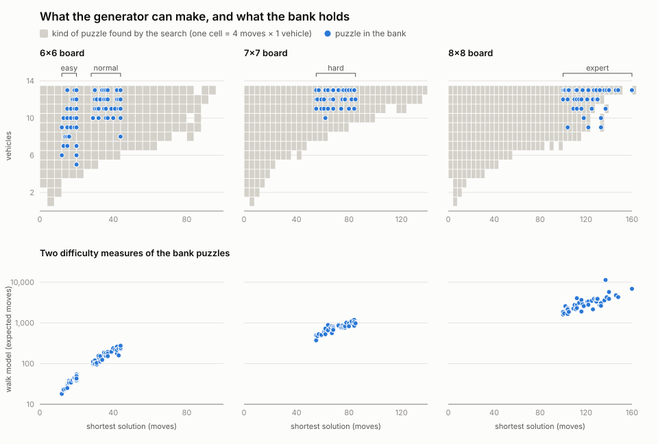

# Tiny Gridlock — diorama build

A photoreal presentation of the Rush Hour APG puzzle. The car park is a 1:43 scale model on a
hobby workbench. Chat commands slide die-cast cars until the red car reaches the exit.


## Run

The page loads ES modules, images and models, so it needs an HTTP server.
Opening `index.html` from the file system does not work.

You need [Bun](https://bun.sh). The libraries (three.js 0.187.0, postprocessing 6.39.6 and
n8ao 2.0.2) are npm packages in `package.json`; `bun.lock` fixes their versions.

```sh
cd diorama
bun install                  # once: the libraries and the tools
bun run dev                  # development server that reloads the page after an edit
```

To show the game to other people, build it and serve the build:

```sh
bun run build                # writes dist/
bun run serve                # http://127.0.0.1:8000/
bun serve.js 0.0.0.0 8000    # reachable from other machines
```

Open the printed address in a desktop browser. The built game needs no network access.
Any static server can serve `dist/`, but `serve.js` compresses the text files and lets the
browser reuse its cached copies (see Load time).

The tools come from [Vite+](https://viteplus.dev) (`vite.config.ts`): Vite builds the game,
Oxlint checks the code and Oxfmt formats it.

```sh
bun run check                # format check and lint
bun run fix                  # apply the format and the lint fixes
bun test                     # unit tests: solver, bank, rules, Auto level, sound, page, server, Twitch bridge
bun run test:flow            # builds the game, then plays it in a headless browser
bun tools/flow.js Twitch     # only the browser tests whose name holds the word (needs a build)
```

The browser tests play the built game as a person and as a chat do. They cover each level,
the welcome screen, the keyboard, the buttons, typed commands, the win card, the camera, the
sound, the Auto level, random chat, Twitch chat with a fake chat server, the Twitch login
return, the page at five screen sizes, and a load that fails. A test fails when the page
reports an error or a request fails. The headless browser draws about 2 frames in a second,
so the whole run takes some minutes.

The flow tests need the Chromium of Playwright. Install it once with
`bunx playwright install chromium`.

## Play

- `blue right`, `red left`, `green up`, `yellow down`: slide a vehicle one cell.
- `blue right 3`: slide up to three cells (1 to 7). Each cell counts as one move.
- `hint`: the next move of a shortest solution, and the number of moves that remain.
  The vehicle flashes its headlights.
- `solve`, or the **Show solution** button: chat gives up, and the game plays a shortest solution
  from the current position. `stop`, or the **Stop** button, ends the replay, and chat goes on
  from that position. A replay is not a solve: the Auto level counts a replay that reaches the
  exit as not solved, and each move of a stopped replay as a hint.
- After a win with more moves than the shortest solution, **Watch the shortest solution** puts
  the cars back and plays it from the start.
- `cam angle`, `cam top`, `cam low`: change the camera. Drag to orbit, scroll to zoom.
- When a move leaves the way to the exit free, the red car drives out by itself. Each cell of
  that drive counts as a move, and the exit counts as one more.

The colour name is printed on each roof, and the panel lists the colours in the puzzle.
Planters are fixed obstacles: no vehicle can pass them.

| Level  | Lot | Shortest solution |
| ------ | --- | ----------------- |
| Easy   | 6×6 | 6 to 11 moves     |
| Medium | 6×6 | 12 to 20 moves    |
| Hard   | 6×6 | 28 to 44 moves    |
| Expert | 7×7 | 55 to 85 moves    |
| Master | 8×8 | 100 to 160 moves  |

The game starts on Easy. Easy is the level for a first game and for a class: a puzzle takes 3
to 10 slides and has 2 to 10 vehicles. The four levels above it were named Easy, Normal, Hard and Expert until 16
November 2026; their puzzles did not change.

One move is one cell. The game deals 40 puzzles per level without repeats, with random colours
and a random top-bottom mirror.

### Auto level

With **Auto**, the game chooses each puzzle from how the audience played the last one
(`src/adapt.js`). All 200 puzzles form one ladder, ordered by shortest solution.

| Last puzzle                                                                                   | Next puzzle                  |
| --------------------------------------------------------------------------------------------- | ---------------------------- |
| Solved in at most 1.5 × the shortest solution, with hints for at most 10% of its moves        | Harder: 8% up the ladder     |
| Solved in more than 2.5 × the shortest solution, or with hints for more than 30% of its moves | Easier: 8% down the ladder   |
| Not solved: chat moved, asked for a hint or the solution, then took a new puzzle              | Easier: 8% down the ladder   |
| Any other result, or a puzzle that nobody touched                                             | The same place on the ladder |

The first Auto puzzle is 10% up the ladder. The game picks at random among the five nearest
puzzles that were not played, at most 8 places away; when none is left there, those puzzles
come again. Moves made before a Reset count in the result. The place on the ladder lasts until
the page reloads. This is
experience-driven procedural content generation (Yannakakis and Togelius, _Artificial
Intelligence and Games_, 2nd edition, section 7.2.3): a model of the player, here three numbers
from the last puzzle, selects the content. The aim is the flow channel between boredom and
anxiety (the same book, p. 329). The thresholds are design values. They are not fitted to
player data.

## Puzzle generation

No puzzle is written by hand. `tools/evolve.js` uses search-based procedural content generation
with MAP-Elites, a quality-diversity evolutionary algorithm.

- The genome is a layout: the vehicles and the planters.
- The exact solver (`src/solver.js`) explores every reachable position of a layout. The start
  position is the one farthest from the exit, so the recorded move count is the true minimum.
- The archive keeps the best layout for each pair (solution length, number of vehicles).
  Quality favours layouts where many vehicles take part and few can never move.
- New layouts come from mutation (add, remove, move or resize a vehicle or a planter) and from
  a row-cut crossover of two kept layouts.

```sh
bun tools/evolve.js search --n 8 --seconds 300 --seed 1   # writes tools/archive/n8-s1.json
bun tools/evolve.js search --n 6 --max 11 --seconds 45 --seed 31   # short puzzles only, for Easy
bun tools/evolve.js bank                                  # picks src/puzzles.json from all archives
bun test                                                  # solver and bank checks
```

`tools/archive/` holds the search results that produced the current bank. In the game, the same
solver runs in a worker and gives the hints.

### Expressive range



`bun tools/range.js` draws this chart. The expressive range of a generator is the set of
content that it can make, shown over a few measures (the book, section 9.7.3). The top row
shows each kind of puzzle that the search found, and the 200 puzzles that the bank took.
The search found puzzles up to 94 moves on 6×6, 138 on 7×7 and 160 on 8×8. The bank uses only
a part of that range: the levels stop at 44 moves on 6×6 and 85 on 7×7, and 143 of the 160 bank
puzzles above Easy have 9 or more vehicles, because the quality score favours busy lots. Easy
is different: a short solution moves few vehicles, so 38 of its 40 puzzles have fewer than 9.

### A second difficulty measure

Each bank entry has an `effort` value next to `moves`. It is the difficulty measure of
Jarušek and Pelánek [1]: a model player moves at random, but a move that brings the exit
closer has a larger weight (the distance to the exit plus 25, against the distance alone).
The measure is the expected number of moves of this player. The paper takes the mean of many
runs; `effort()` in `src/solver.js` solves the same mean exactly, and two tests compare it
with independent calculations.

- In the paper's data from people (45 Rush Hour puzzles on 6×6), the shortest solution and
  this model predict the solving time equally well: Spearman correlation 0.90 for each. The
  size of the state space does not predict it. So the shortest solution stays the measure
  that defines the levels.
- In the bank, the two measures agree closely: rank correlation 1.00 (rounded) over all 200 puzzles,
  and 0.97 (Easy), 0.92 (Medium), 0.91 (Hard), 0.89 (Expert) and 0.81 (Master) inside a level.
  The values go from 7 to 11,364 expected moves. The bottom row of the chart shows both measures.
- The model's weight of 25 comes from the paper. Nobody has fitted it to this game, where one
  move is one cell, and the paper has no 7×7 or 8×8 puzzles.

A second measure from the literature, the structural complexity of Ragni and others [2],
predicted human performance less well than the shortest solution in their own data, so the
bank does not use it.

### Comparison with the complete 6×6 database

Michael Fogleman computed every "interesting" 6×6 Rush Hour puzzle with up to two walls:
2,577,412 clusters of positions [3]. His database holds the hardest position of each cluster
and counts a move as one slide of any length. `bun tools/fogleman.js path/to/rush.txt` finds
each 6×6 bank puzzle in it. The database is not in this repository, because its page states
no licence for it.

|                                                  | Medium                       | Hard                          |
| ------------------------------------------------ | ---------------------------- | ----------------------------- |
| Bank puzzles found in the database               | 38 of 40                     | 39 of 40                      |
| Shortest solution in one-cell moves              | 12 to 20                     | 29 to 44                      |
| Shortest solution in slides                      | 6 to 14 (median 10)          | 15 to 30 (median 22)          |
| Share of all clusters that are easier, in slides | 0.5% to 64.8% (median 22.8%) | 71.8% to 99.6% (median 95.6%) |

- For all 77 puzzles that were found, this solver and the database agree on the number of
  reachable positions and on the largest slide distance in the cluster. This is an
  independent check of the solver.
- The other three puzzles each have a vehicle or a planter that the hardest position does not
  need. The database leaves such puzzles out.
- The hardest puzzle of the database takes 60 slides (51 without walls). The hardest Hard
  puzzle takes 30 slides, and the search archive for 6×6 reaches 94 one-cell moves.
- The database covers 6×6 only, so nothing like it exists for the Expert and Master levels.
- The Easy level was added on 16 November 2026 and is not in the table. The database holds 21 of
  its 40 puzzles, and the solver agrees with it on each. The other 19 have a vehicle or a planter
  that the hardest position does not need.

[1] P. Jarušek and R. Pelánek, "What Determines Difficulty of Transport Puzzles?", Proc.
FLAIRS-24, 2011. <https://cdn.aaai.org/ocs/2518/2518-11200-1-PB.pdf>
[2] M. Ragni, F. Steffenhagen and A. Fangmeier, "A Structural Complexity Measure for
Predicting Human Planning Performance", Proc. CogSci 2011. <https://escholarship.org/uc/item/1wr6b29g>
[3] M. Fogleman, "Solving Rush Hour, the Puzzle", 2018. <https://www.michaelfogleman.com/rush/>
(read 15 November 2026).

URL options for testing: `?skip=1` starts in play, `&cam=top|low` picks the view,
`&level=easy|medium|hard|expert|master|auto` picks the difficulty.

## Play through Twitch chat

Add the channel to the address: `http://localhost:4680/?channel=name`. The game then reads the
chat of that Twitch channel. Reading needs no login. Without `channel`, the game makes no
request to Twitch.

- A command in Twitch chat starts with `!`: `!blue right`, `!blue right 3`. A message without
  `!` is talk, and the game ignores it.
- Each player gets one command in 3 seconds. `&cooldown=5` sets another number of seconds, from 0
  to 60.
- `!hint`, `!solve`, `!stop` and `!cam` do nothing from Twitch chat. The streamers use the
  buttons and the chat box on the page.
- The panel head shows the state: `Twitch: #name`, `Twitch: connecting`, `Twitch: reconnecting`
  or `Twitch: off`. An error, such as a channel that does not answer, appears in the chat panel.
- Messages that arrive before **Start** are dropped.

### Replies in Twitch chat

The game replies in Twitch chat only after a login to Twitch. It replies to a win, and to a
command that it refused or did not understand. A player gets at most one such reply in 10
seconds. The game sends at most 15 replies in 30 seconds, because Twitch allows a normal account
20 messages in 30 seconds
([Twitch developer documentation](https://dev.twitch.tv/docs/chat/), read 15 November 2026).

The steps for the presenter, once for each laptop:

1. Log in to Twitch in the browser with the account that sends the replies.
2. In the [Twitch developer console](https://dev.twitch.tv/console/apps), register an
   application. Set the OAuth redirect URL to the address of the game without options, for
   example `http://localhost:4680/`. Open the game at that same address: the examples of Twitch use
   `http` with `localhost`, and this project did not test another host.
3. Copy the client ID of the application. It is not a secret.
4. Open `http://localhost:4680/?channel=name&client=<client ID>` and select **Log in to
   Twitch** in the panel. Twitch asks for permission to read and write chat, then returns to the
   game.

The login token stays in the storage of that browser. It is never in the repository, and the
game never sends it to the game server. To log out, clear the site data of the game in the
browser. When Twitch no longer accepts the token, the game says so and offers the login again.

### Other chat sources

`window.apg.command(user, text)` feeds one chat message into the game. Another chat client only
needs to call it for each message.

The choices for play through Twitch chat, with the decisions taken so far, are in
[docs/team-decisions.md](docs/team-decisions.md).

## Files

| File                       | Purpose                                                                                     |
| -------------------------- | ------------------------------------------------------------------------------------------- |
| `src/engine.js`            | Puzzle rules, levels, colours, and expansion of a bank entry into a puzzle.                 |
| `src/solver.js`            | Exact breadth-first solver over all reachable positions.                                    |
| `src/puzzles.json`         | The generated puzzle bank.                                                                  |
| `src/worker.js`            | Solves the dealt puzzle off the main thread and answers hints.                              |
| `src/vehicles.js`          | Vehicles modelled in code: lofted bodies, panel lines, glass, mirrors, wheels, roof labels. |
| `src/scene.js`             | Room, workbench, props, board, lights and post-processing.                                  |
| `src/main.js`              | Game flow, camera moves, animation, HUD wiring.                                             |
| `src/audio.js`             | Synthesised sounds (WebAudio). No audio files.                                              |
| `tools/evolve.js`          | The puzzle generator.                                                                       |
| `src/adapt.js`             | The Auto level: the next puzzle from the last result.                                       |
| `tools/range.js`           | Draws `docs/expressive-range.svg`.                                                          |
| `tools/fogleman.js`        | Compares the 6×6 puzzles with Fogleman's database.                                          |
| `tools/solver.test.js`     | Tests: the solver against a plain search, the walk model, and every bank entry.             |
| `tools/adapt.test.js`      | Tests: the Auto level.                                                                      |
| `tools/serve.test.js`      | Tests: the server's path check, cache validation and compression.                           |
| `src/twitch.js`            | The Twitch chat bridge: reads a channel's chat and replies in it.                           |
| `tools/twitch.test.js`     | Tests: the Twitch chat bridge, with a fake connection.                                      |
| `tools/flow.js`            | Tests: the game flow in a headless browser (`bun run test:flow`).                           |
| `tools/engine.test.js`     | Tests: the rules of a move, with random positions.                                          |
| `tools/page.test.js`       | Tests: the page, the levels, the bank and this README name the same things.                 |
| `tools/audio.test.js`      | Tests: the sounds, with a fake audio device.                                                |
| `tools/assets.sh`          | Converts the original images and models into `public/assets/`.                              |
| `public/assets/`           | Images and models. The build copies them to `dist/assets/` unchanged.                       |
| `package.json`, `bun.lock` | The libraries, the tools and the commands.                                                  |
| `vite.config.ts`           | Build, lint and format settings (Vite+).                                                    |
| `serve.js`                 | Static server for `dist/` with compression and cache validation.                            |
| `garage.html`              | Developer page that shows every vehicle model.                                              |

## Load time

A first visit to the built game transfers about 6.2 MB in 20 requests.
Before the load-time work it was 27.9 MB in 70 requests. A repeat visit transfers almost nothing: the browser checks each file and the server answers "304 Not Modified".

- **Images** are WebP. The backdrop loads in two steps: a 2k photo for the first frame, then
  the 6k photo, which replaces it without a pause.
- **Loading screen**: a 40-pixel WebP of the welcome view is inline in `index.html` (`#preview`)
  and shown blurred until the first frame. To renew it after a change to the welcome view, take
  a screenshot with `#welcome` hidden, run `magick shot.png -resize 40x -quality 60 lq.webp`,
  and put the Base64 text of the file in the `#preview` rule.
- **Models** are one `.glb` file each, with Meshopt-compressed geometry and WebP textures.
- **Lighting** uses a 512 × 256 HDR map. A close-up of the cars lit by the 1024 × 512 map
  showed no visible difference.
- **Code**: the build puts the game and its libraries into three minified files (page, engine,
  solver worker) and leaves out library code that the game does not use. The page preloads
  the engine file, so the browser fetches the code at once and not one import level at a time.
- **Server**: `serve.js` sends text and the HDR map as Brotli or gzip, and gives every file an
  `ETag` with `Cache-Control: no-cache`. The browser checks each file, but it never downloads
  an unchanged file twice.

`tools/assets.sh` rebuilds `public/assets/` from the original Poly Haven downloads.
To update a library, change its version in `package.json` and run `bun install`.

## Credits

All third-party assets are CC0 from [Poly Haven](https://polyhaven.com): the `artist_workshop`
HDRI and its backdrop photo; the `asphalt_02` and `plywood` textures; and the models
`wooden_table_02`, `desk_lamp_arm_01`, `spray_paint_bottles`, `pliers`, `screwdrivers_02`,
`measuring_tape_01`, `potted_plant_04` and `street_lamp_01`.

Libraries: three.js (MIT), postprocessing (Zlib), n8ao (ISC). Their licence files are in their packages under `node_modules/`.
The build keeps the licence notices of three.js and postprocessing in the engine file.
